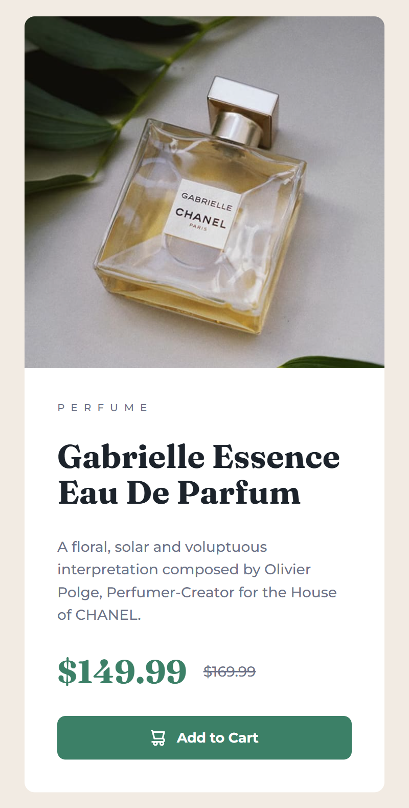

# Frontend Mentor - Product preview card component solution

This is a solution to the [Product preview card component challenge on Frontend Mentor](https://www.frontendmentor.io/challenges/product-preview-card-component-GO7UmttRfa). Frontend Mentor challenges help you improve your coding skills by building realistic projects. 

## Table of contents

- [Overview](#overview)
  - [The challenge](#the-challenge)
  - [Screenshot](#screenshot)
  - [Links](#links)
- [My process](#my-process)
  - [Built with](#built-with)
  - [What I learned](#what-i-learned)
  - [Continued development](#continued-development)
  - [AI Collaboration](#ai-collaboration)
- [Author](#author)

## Overview

### The challenge

Users should be able to:

- View the optimal layout depending on their device's screen size
- See hover and focus states for interactive elements

### Screenshot

#### Desktop

#### Mobile

### Links

- Solution URL: [GitHub Repository](https://github.com/rolando2012/fm-product-preview-card)
- Live Site URL: [Live Demo](https://rolando2012.github.io/fm-product-preview-card/)

## My process

### Built with

- Semantic HTML5 markup
- CSS custom properties
- Flexbox
- CSS Grid
- Mobile-first workflow
- Google Fonts (Montserrat & Fraunces)

### What I learned

During this challenge, I reinforced my HTML and CSS fundamentals and picked up several best practices:

- **Responsive Art Direction with `<picture>`:** I learned how to serve different images for mobile and desktop using `<picture>` and `<source media="(min-width: ...)">`. This avoids downloading both files or hiding them with CSS, improving performance.
- **Semantic HTML & Accessibility:** I practiced proper heading hierarchy using `<h1>`, used the `<del>` tag to semantically mark up the original price, and learned to leave the `alt=""` attribute empty on decorative icons so screen readers skip them.
- **Fixing `<picture>` / `` Extra Bottom Space:** I discovered why inline images leave a tiny gap at the bottom due to line-height/baseline alignment, and fixed it by setting `display: block` on the `` element.
- **Mobile-First CSS Grid & Centering:** I centered the main card cleanly on the viewport using CSS Grid (`place-items: center`), and transitioned from a single-column mobile layout to a two-column desktop card using `grid-template-columns: 1fr 1fr`.
- **Google Fonts & CSS Custom Properties:** I learned how to load multiple Google Fonts efficiently in a single request and organize the design system's color palette using global CSS variables (`:root`).

### Continued development

Moving forward, I plan to complete around **three more CSS challenges** to solidify my responsive layout skills before transitioning to **Tailwind CSS** with a strong foundational understanding. 

My next challenge will be the **[Bento grid](https://frontendmentor.io)** component, where I want to practice more complex multi-column and multi-row CSS Grid layouts.

### AI Collaboration

During this project, I used an AI assistant (Gemini) as a **learning tutor** rather than a code generator:

- **Syntax refresher:** I asked for quick syntax reminders using isolated examples unrelated to the challenge, so I could apply the concepts myself.
- **Code review & critical thinking:** Once my solution was built, I used it to review my HTML/CSS and spot subtle visual differences against the design. Instead of blindly accepting suggestions, I evaluated each recommendation to decide whether the change was truly worth implementing.

## Author

- Frontend Mentor - [@rolando2012](https://www.frontendmentor.io/profile/rolando2012)
- Github - [@rolando2012](https://github.com/rolando2012)
- LinkedIn - [Rolando Mercado Rojas
](https://www.linkedin.com/in/rolando-mercado-rojas/)